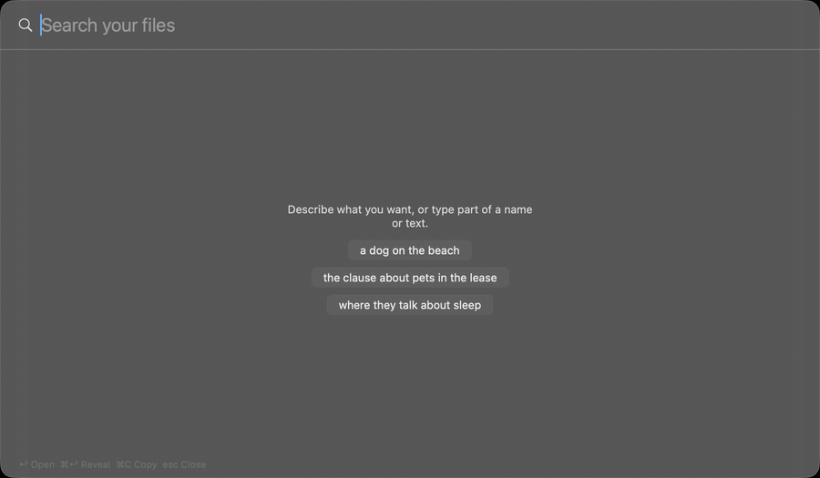

# Sesame

Sesame is a Mac app that finds files by what is inside them: photos, PDFs, documents, recordings and videos. Press a shortcut in any app, describe what you want, and press Enter. The file opens at the right spot.

Privacy promise: everything stays on your Mac and nothing about your files, your text or your searches is sent anywhere. The only download is the model file, once, from huggingface.co. Sesame only reads your files. It never changes, moves or deletes one.

## Screenshots



The search panel from shortcut to result.

First-run Setup lists folders with counts and a time estimate before anything is indexed.

The screenshots use made-up demo files.

## What it does

- Press Control+Option+Space in any app to open the search panel. You can change the shortcut in Settings.
- Describe what you want, for example "a dog on the beach". Results appear on the left and a preview on the right.
- Enter opens the file. A PDF opens in Preview on the matching page. An audio or video file opens in QuickTime Player at the matching moment. Command+Enter reveals the file in Finder.
- Text inside photos and screenshots is read with Apple's text recognition, so you can also search for exact words.
- Sesame is a menu bar app. Its menu shows the indexing status: Ready, Indexing, Paused or Downloading.
- Settings has four sections: Folders, File types, Search and Indexing.
- First-run Setup lets you pick folders and shows counts and a time estimate. Nothing is indexed until you press Start indexing.

Files Sesame reads, by extension. Anything else is ignored.

| Kind      | Extensions                       |
| --------- | -------------------------------- |
| Photos    | JPEG, PNG, HEIC, WebP, TIFF, GIF |
| PDFs      | pdf                              |
| Documents | txt, md, rtf, docx, html, odt    |
| Audio     | mp3, m4a, wav, aac, flac         |
| Video     | mp4, mov, m4v                    |

A damaged file, or a password-protected PDF, is skipped and listed in Settings as "could not read". It does not stop the rest.

## What it never reads

- Key and password files, in any folder: `.pem`, `.key`, `.p12`, `.pfx`, `id_rsa*`, `.env*`, `*.kdbx`.
- Inside a git repo: anything git ignores, and folders named `node_modules`, `Pods`, `build`, `dist`, `.build` or `vendor`.
- Code files. Code search is not in this release.

## Requirements

- Apple Silicon Mac.
- macOS 14 or later. On macOS 26 and later the Setup window uses Liquid Glass. On macOS 14 to 25 it has the plain look.
- Swift 6.2 or newer. `Package.swift` requires tools version 6.2, and `scripts/verify.sh` says to install the full Xcode if swift is missing or too old. Whether the command line tools alone are enough is not confirmed.
- cmake and git, to build llama.cpp (`scripts/build-llama.sh` calls both).
- About 865 MB of disk for the model. Sesame downloads it on first run.

## Install

1. Download `Sesame-1.0.0.dmg` from the Releases page of this repository.
2. Open it and drag Sesame to Applications.
3. Open Sesame from Applications.

It needs macOS 14 or later on Apple silicon. The first run downloads the search model (about 865 MB) and asks for the permissions listed in Requirements.

## Build and run

These steps come from reading the scripts. None of them were run for this README.

1. Clone the repo.
2. Get llama.cpp into `third_party/llama.cpp` and build it:

   ```
   scripts/build-llama.sh
   ```

   The script clones `https://github.com/ggml-org/llama.cpp` at tag b11461 (commit 4d756bc) into `third_party/llama.cpp` if that folder has no `.git`. It refuses any other commit. It applies two patches from `scripts/`, then builds static libraries with Metal into `third_party/llama.cpp/build`. `SESAME_LLAMA_PATCH=0` skips the second patch (`llama.cpp-no-logits.patch`). The first patch (`llama.cpp-vision-only.patch`) is always applied.

   llama.cpp is not in the repo. A fresh clone has no `third_party/llama.cpp` folder, and `scripts/build-llama.sh` fetches the pinned version into it and applies the patches. This was read from the script and not run on a fresh clone, so it is not confirmed.

3. Build the app and the helper:

   ```
   swift build -c release
   ```

   `scripts/verify.sh` builds with `-Xswiftc -warnings-as-errors`. Plain `swift build -c release` is what `scripts/bundle.sh` asks for.

4. Make the app bundle:

   ```
   scripts/bundle.sh
   ```

   This writes `dist/Sesame.app`. It copies `Resources/Info.plist` and `Resources/AppIcon.icns`, the `Sesame` binary and the `SesameHelper` binary. It needs `Resources/AppIcon.icns`, which is in the repo. If it is missing, run `scripts/make-icon.swift`.

5. Open `dist/Sesame.app`.

Signing: `bundle.sh` signs ad hoc (`codesign --sign -`). The helper is signed first. The app is signed with `Resources/Sesame.entitlements`, which holds one entry, Apple Events automation. There is no developer ID signing, notarization or installer. Whether macOS Gatekeeper lets an ad hoc signed copy open on another Mac was not checked.

First launch:

- The Setup window starts. Pick folders and press Start indexing. Nothing is read before that.
- Sesame downloads the two model files (about 865 MB together) from huggingface.co. It checks size and checksum.
- macOS may ask for permission to read folders such as Desktop and Documents. These prompts come from macOS and were not checked here.
- Opening a video or audio file at a moment asks QuickTime Player to start there. macOS asks for Automation permission (`NSAppleEventsUsageDescription` in `Info.plist`).
- Speech recognition: `Info.plist` has a usage string saying Sesame turns 30 seconds of a recording into words on this Mac with Apple's speech recognition. The spec says this prompt may appear.
- Sesame never asks for Full Disk Access, camera or microphone.

For maintainers: `scripts/release.sh` makes the signed and notarized DMG. It needs a Developer ID Application certificate and a notarytool keychain profile.

Sesame keeps its model, index and settings in `~/Library/Application Support/Sesame/`.

Not confirmed by reading: that the whole sequence works on a clean Mac, the exact prompts macOS shows, and whether the build needs anything beyond the tools named above.

## Project layout

- `Sources/Sesame`: the app. Menu bar, search panel, Setup, Settings.
- `Sources/SesameEngine`: the library. Rules, file reading, index, search, model files, protocol.
- `Sources/SesameHelper`: the helper process that encodes and indexes.
- `Sources/CLlama`: the C module map for the llama.cpp headers.
- `Tests`: `EngineTests`, `AppLogicTests`, `GoldenTests`.
- `scripts`: build, bundle, verify and test-kit scripts.
- `Resources`: `Info.plist`, `Sesame.entitlements`, `AppIcon.icns`.
- `fixtures`: `answers.csv`, the answer key for the golden test files. The kit scripts build the test files elsewhere, not in the repo.

## Testing

```
swift test
```

`scripts/verify.sh` runs `swift test --no-parallel`. The tests need the llama.cpp build from step 2. Not run for this README.

The scripts named `kit-*` drive the real app and build test files:

- `scripts/kit-static.sh` runs `scripts/check-static.sh`, which checks the source for 17 rules (needs perl) and saves the output.
- `scripts/kit-fixtures.sh` builds test files, such as the golden set and a fixture tree, outside the repo. It uses tools like ffmpeg.
- `scripts/kit-golden.sh` checks ranking against the answer key in `fixtures/answers.csv`.
- `scripts/kit-run.sh` runs the real-app checks, one line per check.
- `scripts/verify.sh` builds, bundles and runs the checks. It launches the app and asks for macOS permissions. Do not run it while you use the Mac.

## Status

Version 1.0.0. Code search is not in this release.

Some real-app proof checks have not been run yet, so parts of the app are covered by unit tests only.

## Contributing

Open an issue before a big change. Write the test first. Write no comments in code unless the reason is not obvious. Keep changes small and in line with what the repo already does.

## License

Sesame is released under the MIT License (see LICENSE). llama.cpp is fetched at build time under its own MIT licence. The EmbeddingGemma model is downloaded at first run and is covered by its own terms from its publisher; read them before you use or redistribute it.
